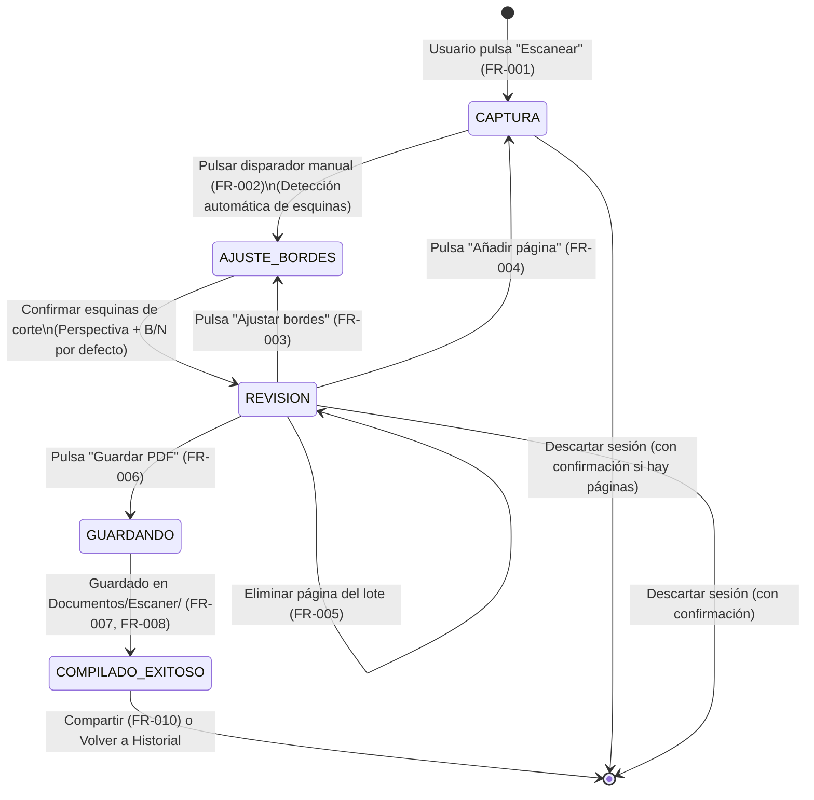

# Data Model: Escaner v1 - Escaneo de Documentos y Exportación a PDF

**Feature Branch**: `001-document-scanner`  
**Date**: 2026-11-02  
**Status**: Completed  

Este documento describe las entidades de datos, modelos de estado, validaciones y reglas de negocio para la aplicación Escaner v1, mapeando los requisitos de `spec.md`.

---

## 1. Entidades Principales

```
+-------------------------------------------------------+
|                     SesionLote                        |
+-------------------------------------------------------+
| id: String (UUID)                                     |
| estado: EstadoSesion                                  |
| fechaInicio: Long (epoch millis)                      |
| paginas: List<PaginaDocumento>                        |
+-------------------------------------------------------+
                            | 1
                            | contiene (1..20)
                            v *
+-------------------------------------------------------+
|                   PaginaDocumento                     |
+-------------------------------------------------------+
| id: String (UUID)                                     |
| indice: Int (1..N)                                    |
| archivoCapturaOriginal: File                          |
| esquinasCorte: PoligonoCuatroPuntos                   |
| rotacion: RotacionGrados                              |
| modoColor: ModoColor                                  |
| archivoProcesadoTemp: File?                           |
| estadoAprobacion: EstadoPagina                        |
+-------------------------------------------------------+

                            | (Compilado final)
                            v
+-------------------------------------------------------+
|                     DocumentoPDF                      |
+-------------------------------------------------------+
| id: Long (MediaStore ID / Hash)                       |
| nombre: String (ej. Escaner_20261102_101530.pdf)      |
| uri: Uri (content://...)                              |
| rutaFisica: String (Documentos/Escaner/...)           |
| fechaCreacion: Long (epoch millis)                    |
| tamanoBytes: Long                                     |
| cantidadPaginas: Int                                  |
+-------------------------------------------------------+
```

---

## 2. Definición Detallada de Entidades

### 2.1. `DocumentoPDF` (Persistente en almacenamiento)

Representa un documento PDF compilado y almacenado de forma permanente en la carpeta pública del dispositivo.

| Campo | Tipo | Requerido | Descripción | Reglas de Validación / Formato |
| :--- | :--- | :--- | :--- | :--- |
| `id` | `Long` | Sí | Identificador único en `MediaStore` o hash numérico de ruta | Único por archivo |
| `nombre` | `String` | Sí | Nombre del archivo con extensión | Termina en `.pdf`, no vacío, caracteres válidos de SO (`^[^\\/:*?"<>|]+$`), nombre no duplicado en el directorio |
| `uri` | `android.net.Uri` | Sí | URI `content://` accesible para compartir y visualizar | Generado vía MediaStore / FileProvider |
| `rutaFisica` | `String` | Sí | Ruta relativa o absoluta en almacenamiento | Siempre bajo `Documents/Escaner/` |
| `fechaCreacion` | `Long` | Sí | Timestamp de creación en milisegundos | `> 0` |
| `tamanoBytes` | `Long` | Sí | Tamaño del archivo en bytes | `>= 0` |
| `cantidadPaginas` | `Int` | Sí | Total de páginas contenidas en el PDF | `>= 1` |

#### Funciones y Propiedades Derivadas:
- `tamanoFormateado: String`: Conversión legible para humanos en español (ej. `"450 KB"`, `"1.8 MB"`).
- `fechaFormateada: String`: Representación visual para historial (ej. `"Hoy, 10:15 a. m."`, `"2 nov 2026, 14:30"`).

---

### 2.2. `SesionLote` (En memoria / Estado de sesión)

Representa la sesión de trabajo temporal mientras el usuario captura, revisa y organiza una o varias páginas antes de compilar el PDF definitivo.

| Campo | Tipo | Requerido | Descripción | Reglas de Validación |
| :--- | :--- | :--- | :--- | :--- |
| `id` | `String` | Sí | UUID de la sesión | Formato UUID v4 |
| `estado` | `EstadoSesion` | Sí | Estado del ciclo de vida de la sesión | Ver máquina de estados abajo |
| `fechaInicio` | `Long` | Sí | Momento en que se inició el escaneo | Timestamp en milisegundos |
| `paginas` | `List<PaginaDocumento>` | Sí | Lista mutable ordenada de páginas | Mínimo 1 para compilar; máximo 20 páginas por lote (SC-006) |

#### Estados de Sesión (`EstadoSesion`):
- `CAPTURA`: Cámara activa, listo para tomar fotografía.
- `AJUSTE_BORDES`: Visualizando y ajustando las 4 esquinas de corte.
- `REVISION`: Previsualizando la página procesada con selector de color, rotación y carrusel de lote.
- `GUARDANDO`: Compilando y escribiendo el archivo PDF en disco.
- `COMPILADO_EXITOSO`: PDF creado en almacenamiento; listo para compartir o ver.
- `CANCELADO`: Sesión descartada por el usuario (tras confirmación) o finalizada.

---

### 2.3. `PaginaDocumento` (Temporal de sesión)

Representa una captura individual dentro de una sesión de escaneo, incluyendo sus parámetros de transformación y procesamiento.

| Campo | Tipo | Requerido | Descripción | Reglas de Validación |
| :--- | :--- | :--- | :--- | :--- |
| `id` | `String` | Sí | Identificador de la página | UUID v4 |
| `indice` | `Int` | Sí | Orden secuencial (1-based) en el lote | `1 <= indice <= 20` |
| `archivoCapturaOriginal` | `java.io.File` | Sí | Archivo JPG temporal de alta resolución de la toma | Archivo existe en cache temporal |
| `esquinasCorte` | `PoligonoCuatroPuntos` | Sí | Coordenadas normalizadas o absolutas de los 4 vértices | Debe formar un cuadrilátero convexo no degenerado |
| `rotacion` | `RotacionGrados` | Sí | Ángulo de rotación manual aplicado | Uno de: `0°`, `90°`, `180°`, `270°` (Default: `0°`) |
| `modoColor` | `ModoColor` | Sí | Modo de procesamiento de color activo | Default: `BLANCO_Y_NEGRO` (FR-002, FR-017) |
| `archivoProcesadoTemp` | `java.io.File?` | No | Cache de la imagen rectificada y filtrada | Generado para preview rápido y compilación |
| `estadoAprobacion` | `EstadoPagina` | Sí | Estado de aprobación de la página | `PENDIENTE` o `APROBADA` |

---

### 2.4. Value Objects y Tipos Auxiliares

#### `PoligonoCuatroPuntos`
Representa los 4 vértices del documento en el espacio de coordenadas de la imagen:
- `topLeft: PointF` (Esquina superior izquierda)
- `topRight: PointF` (Esquina superior derecha)
- `bottomRight: PointF` (Esquina inferior derecha)
- `bottomLeft: PointF` (Esquina inferior izquierda)

*Métodos de validación y utilidad*:
- `esConvexo(): Boolean`: Valida que los 4 puntos formen un polígono convexo (sin auto-intersecciones ni esquinas invertidas).
- `toFloatArray(): FloatArray`: Retorna `[tl.x, tl.y, tr.x, tr.y, br.x, br.y, bl.x, bl.y]` listo para `Matrix.setPolyToPoly`.
- `companion object fromRectConMargen(ancho: Float, alto: Float, margenPorcentaje: Float = 0.05f)`: Genera el rectángulo por defecto cuando no hay contraste suficiente.

#### `ModoColor` (Enum)
- `BLANCO_Y_NEGRO`: Binarización de alto contraste optimizada para texto y sellos de facturas. (Valor por defecto según FR-002 y FR-017).
- `COLOR`: Corrección de niveles conservando colores originales del documento.
- `ESCALA_GRISES`: Desaturación uniforme basada en luminancia estándar.

#### `RotacionGrados` (Enum)
- `ROT_0` (0°)
- `ROT_90` (90° horario)
- `ROT_180` (180° horario)
- `ROT_270` (270° horario)

*Operación*:
- `rotarHorario(): RotacionGrados`: Avanza cíclicamente `(rotacion + 90) % 360`.

---

## 3. Transiciones de Estado

### 3.1. Flujo de Estados del Escaneo



### 3.2. Reglas de Transición y Limpieza

1. **Eliminación de página en revisión (FR-005)**:
   - Al eliminar una `PaginaDocumento` de `SesionLote.paginas`:
     - Se elimina su archivo temporal de cache.
     - Los índices de las páginas restantes se recalculan inmediatamente (`indice = 1..N`).
     - Si la lista queda vacía (0 páginas), la sesión regresa automáticamente a `CAPTURA`.
2. **Confirmación de abandono de lote (Edge Case)**:
   - Si `SesionLote.paginas.size >= 1` y el usuario intenta salir (botón Atrás o cerrar), se despliega `ConfirmDiscardBatchDialog`. Si confirma, se purgan todos los archivos temporales de la sesión.
3. **Guardado exitoso (FR-007, FR-008)**:
   - Se crea el archivo `Documentos/Escaner/Escaner_AAAAMMDD_HHMMSS.pdf`.
   - Se limpian todos los bitmaps y archivos temporales de cache.
   - Se añade el nuevo `DocumentoPDF` al historial visible.
