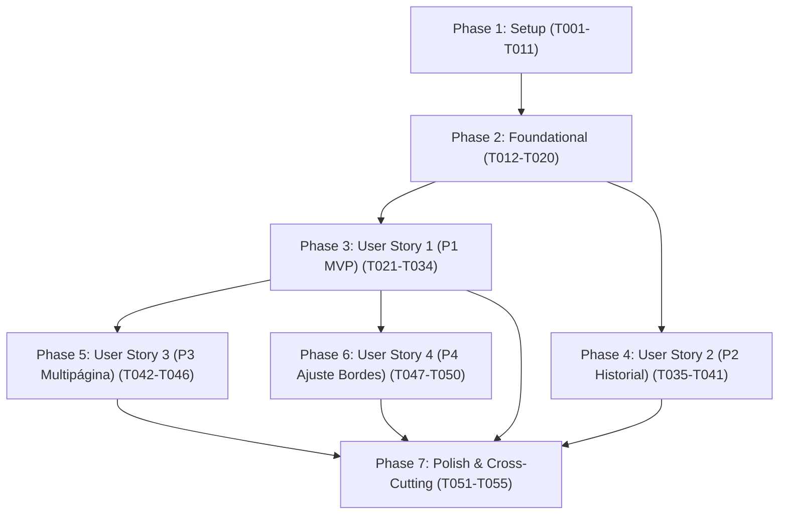

# Tasks: Escaner v1 - Escaneo de Documentos y Exportación a PDF

**Input**: Design documents from `specs/001-document-scanner/`
- [spec.md](./spec.md): Requisitos funcionales (FR-001 a FR-019), historias de usuario y criterios de éxito
- [plan.md](./plan.md): Arquitectura nativa Kotlin + Compose, dependencias y estructura de directorios
- [data-model.md](./data-model.md): Entidades (`DocumentoPDF`, `SesionLote`, `PaginaDocumento`), enums y reglas de validación
- [contracts/](./contracts/): Contratos de UI (`ui-contracts.md`) y contratos de integración Android (`system-contracts.md`)
- [research.md](./research.md): Decisiones técnicas de CameraX, `Matrix.setPolyToPoly`, `PdfDocument` y Scoped Storage
- [quickstart.md](./quickstart.md): Guía de validación y escenarios de prueba de usuario
- Constitution: [.specify/memory/constitution.md](../../.specify/memory/constitution.md) (7 principios fundamentales)

**Organization**: Las tareas están organizadas por fases y agrupadas por historia de usuario para permitir su implementación y verificación independiente.

## Format: `[ID] [P?] [Story] Description with file path`

- **Checkbox**: `- [ ]` obligatorio al inicio de cada tarea
- **[P]**: Tarea paralelizable (archivos independientes, sin dependencias bloqueantes no resueltas)
- **[Story]**: Etiqueta de historia de usuario (`[US1]`, `[US2]`, `[US3]`, `[US4]`) en fases de historias
- Incluye rutas de archivo exactas en cada descripción

---

## Phase 1: Setup (Shared Infrastructure)

**Purpose**: Inicialización del proyecto Android, configuración de Gradle, manifiesto nativo y recursos base.

- [X] T001 Create root and app Gradle build scripts with Kotlin 2.0+, Jetpack Compose BOM, Material 3, and CameraX 1.4+ in build.gradle.kts, settings.gradle.kts, and app/build.gradle.kts
- [X] T002 [P] Configure Gradle wrapper properties with Gradle 8.7+ in gradle/wrapper/gradle-wrapper.properties
- [X] T003 [P] Configure Proguard rules for Android Jetpack and CameraX in app/proguard-rules.pro
- [X] T004 [P] Configure AndroidManifest.xml with camera permissions (no android.permission.INTERNET), hardware features, and FileProvider declaration in app/src/main/AndroidManifest.xml
- [X] T005 [P] Configure FileProvider paths XML for sharing PDFs from Documents/Escaner in app/src/main/res/xml/file_paths.xml
- [X] T006 [P] Configure UI string resources in Colombian Spanish for all screens, dialogs, buttons, and permissions in app/src/main/res/values/strings.xml
- [X] T007 [P] Configure theme colors and Material 3 palettes in app/src/main/java/com/escaner/app/ui/theme/Color.kt
- [X] T008 [P] Configure Material 3 typography definitions in app/src/main/java/com/escaner/app/ui/theme/Type.kt
- [X] T009 Configure Material 3 theme wrapper in app/src/main/java/com/escaner/app/ui/theme/Theme.kt
- [X] T010 [P] Create EscanerApplication class in app/src/main/java/com/escaner/app/EscanerApplication.kt
- [X] T011 Create MainActivity with Compose setContent container in app/src/main/java/com/escaner/app/MainActivity.kt

---

## Phase 2: Foundational (Blocking Prerequisites)

**Purpose**: Modelos de datos, enums, value objects, persistencia con Scoped Storage y navegación central.

**⚠️ CRITICAL**: Ninguna historia de usuario puede implementarse antes de completar esta fase.

- [X] T012 [P] Create ModoColor enum with values BLANCO_Y_NEGRO (default), COLOR, and ESCALA_GRISES in app/src/main/java/com/escaner/app/data/model/ModoColor.kt
- [X] T013 [P] Create RotacionGrados enum with values ROT_0 (0°), ROT_90 (90°), ROT_180 (180°), ROT_270 (270°) and rotarHorario(): RotacionGrados method cycling (rotacion + 90) % 360 in app/src/main/java/com/escaner/app/data/model/RotacionGrados.kt
- [X] T014 [P] Create PoligonoCuatroPuntos value object with PointF vertices topLeft, topRight, bottomRight, bottomLeft, validation rule esConvexo(): Boolean checking non-degenerate convex quadrilateral, toFloatArray(): FloatArray returning 8 floats [tl.x, tl.y, tr.x, tr.y, br.x, br.y, bl.x, bl.y], and companion fromRectConMargen(ancho, alto, 0.05f) in app/src/main/java/com/escaner/app/data/model/PoligonoCuatroPuntos.kt
- [X] T015 [P] Create DocumentoPDF entity with fields id: Long, nombre: String with constraint "termina en .pdf, no vacio, caracteres validos ^[^\\/:*?\"<>|]+$, nombre no duplicado en el directorio", uri: Uri, rutaFisica: String under Documents/Escaner/, fechaCreacion: Long > 0, tamanoBytes: Long >= 0, cantidadPaginas: Int >= 1, and formatted helpers tamanoFormateado and fechaFormateada in app/src/main/java/com/escaner/app/data/model/DocumentoPDF.kt
- [X] T016 [P] Create PaginaDocumento entity with fields id: String UUID, indice: Int with constraint "1 <= indice <= 20", archivoCapturaOriginal: File, esquinasCorte: PoligonoCuatroPuntos, rotacion: RotacionGrados default ROT_0, modoColor: ModoColor default BLANCO_Y_NEGRO, archivoProcesadoTemp: File?, and estadoAprobacion: EstadoPagina in app/src/main/java/com/escaner/app/data/model/PaginaDocumento.kt
- [X] T017 [P] Create SesionLote entity with fields id: String UUID, estado: EstadoSesion (CAPTURA, AJUSTE_BORDES, REVISION, GUARDANDO, COMPILADO_EXITOSO, CANCELADO), fechaInicio: Long, and paginas: List<PaginaDocumento> with constraint "minimo 1 para compilar; maximo 20 paginas por lote" in app/src/main/java/com/escaner/app/data/model/SesionLote.kt
- [X] T018 Unit test for DocumentoPDF validation rules (filename regex, formatting helpers) in app/src/test/java/com/escaner/app/data/DocumentoPDFValidationTest.kt
- [X] T019 Implement DocumentosRepository with Scoped Storage MediaStore.Files querying Documents/Escaner/ ordered by DATE_ADDED DESC, file deletion, and file renaming in app/src/main/java/com/escaner/app/data/repository/DocumentosRepository.kt
- [X] T020 Implement AppNavigation host defining routes Home, Camera, Crop, Review, and cross-screen batch session state sharing in app/src/main/java/com/escaner/app/ui/navigation/AppNavigation.kt

**Checkpoint**: Base de datos y arquitectura lista. Las historias de usuario pueden comenzar.

---

## Phase 3: User Story 1 - Captura individual, recorte automático y exportación a PDF (Priority: P1) ⭐ MVP

**Goal**: Permitir abrir la cámara, apuntar a una factura física, disparar manualmente, recortar automáticamente con corrección de perspectiva (`Matrix.setPolyToPoly`), aplicar filtro Blanco y Negro por defecto (con opción de alternar Color o Grises y rotar 90° horario), compilar el PDF con nombre `Escaner_AAAAMMDD_HHMMSS.pdf` en `Documentos/Escaner/` y mostrar confirmación con botón para compartir nativo.

**Independent Test**: Colocar el teléfono en Modo Avión, abrir la app, fotografiar un recibo sobre un escritorio, confirmar la captura y verificar que el archivo `.pdf` aparezca legible y enderezado en la carpeta `Documentos/Escaner/` en menos de 10 segundos.

### Tests for User Story 1

- [X] T021 [P] [US1] Unit test for PerspectiveCorrector Matrix.setPolyToPoly 2D projection in app/src/test/java/com/escaner/app/domain/PerspectiveCorrectorTest.kt
- [X] T022 [P] [US1] Unit test for ImageColorFilter B/N high contrast binarization, grayscale luminance, and 90-degree rotation in app/src/test/java/com/escaner/app/domain/ImageColorFilterTest.kt
- [X] T023 [P] [US1] Unit test for PdfCompiler single-page PDF generation via android.graphics.pdf.PdfDocument in app/src/test/java/com/escaner/app/domain/PdfCompilerTest.kt

### Implementation for User Story 1

- [X] T024 [P] [US1] Implement EdgeDetector with thumbnail downscaling to 600px, luminance gradient edge estimation, and fallback to 5% safe margin rectangle in app/src/main/java/com/escaner/app/domain/EdgeDetector.kt
- [X] T025 [P] [US1] Implement PerspectiveCorrector using android.graphics.Matrix.setPolyToPoly mapping 4 corner points to flat rectangular destination [0, 0, W, 0, W, H, 0, H] on Canvas in app/src/main/java/com/escaner/app/domain/PerspectiveCorrector.kt
- [X] T026 [P] [US1] Implement ImageColorFilter with ColorMatrix filters for BLANCO_Y_NEGRO high contrast binarization (default), COLOR original optimization, ESCALA_GRISES (Y = 0.299R + 0.587G + 0.114B), and 90-degree clockwise rotation in app/src/main/java/com/escaner/app/domain/ImageColorFilter.kt
- [X] T027 [P] [US1] Implement PdfCompiler for single-page and sequential page rendering to PdfDocument and writing to FileOutputStream with automatic timestamp Escaner_AAAAMMDD_HHMMSS.pdf in app/src/main/java/com/escaner/app/domain/PdfCompiler.kt
- [X] T028 [P] [US1] Implement CameraControls with manual capture shutter button, flash/torch toggle button checking hasFlashUnit(), and close button in app/src/main/java/com/escaner/app/ui/camera/components/CameraControls.kt
- [X] T029 [US1] Implement CameraViewModel managing CameraX Preview and ImageCapture lifecycle, torch state toggle, manual photo capture, and EdgeDetector invocation in app/src/main/java/com/escaner/app/ui/camera/CameraViewModel.kt
- [X] T030 [US1] Implement CameraScreen embedding CameraX PreviewView, runtime camera permission request flow, and CameraControls in app/src/main/java/com/escaner/app/ui/camera/CameraScreen.kt
- [X] T031 [P] [US1] Implement ColorSelectorBar offering fast 3-mode selector (Blanco y Negro default, Color, Escala de grises) in app/src/main/java/com/escaner/app/ui/review/components/ColorSelectorBar.kt
- [X] T032 [US1] Implement ReviewViewModel handling single page review state, color mode switching, 90-degree clockwise rotation, invoking PdfCompiler, and saving to Documents/Escaner/ in app/src/main/java/com/escaner/app/ui/review/ReviewViewModel.kt
- [X] T033 [US1] Implement ReviewScreen displaying high-resolution processed page preview with zoom/pan, ColorSelectorBar, 90-degree clockwise rotation button, save PDF button, and save confirmation dialog in app/src/main/java/com/escaner/app/ui/review/ReviewScreen.kt
- [X] T034 [US1] Implement native share trigger helper deploying Android Sharesheet via Intent.ACTION_SEND with FileProvider content URI upon save confirmation in app/src/main/java/com/escaner/app/ui/review/ReviewScreen.kt

**Checkpoint**: User Story 1 está 100% funcional de forma independiente como MVP mínimo viable de digitalización.

---

## Phase 4: User Story 2 - Historial de documentos, gestión y compartir mediante la hoja nativa (Priority: P2)

**Goal**: Mostrar en la pantalla principal la lista cronológica de PDFs en `Documentos/Escaner/`, abrir en visor de PDF externo con `Intent.ACTION_VIEW`, compartir vía `Android Sharesheet`, renombrar con validaciones estrictas y eliminar archivos físicamente con diálogo de confirmación.

**Independent Test**: Con al menos un PDF generado previamente, abrir la app, verificar que aparece en el historial, compartir el archivo hacia otra app mediante la hoja nativa, renombrar el archivo validando el cambio en el sistema de archivos, y eliminarlo con confirmación comprobando que desaparece de `Documentos/Escaner/`.

### Tests for User Story 2

- [X] T035 [P] [US2] UI test for HomeScreen document list rendering, empty state display, and action triggers in app/src/androidTest/java/com/escaner/app/ui/HomeScreenUiTest.kt

### Implementation for User Story 2

- [X] T036 [P] [US2] Implement DocumentoItem row showing PDF icon, filename, formatted date, formatted size, page count, and action buttons for share, rename, delete in app/src/main/java/com/escaner/app/ui/home/components/DocumentoItem.kt
- [X] T037 [P] [US2] Implement EmptyHistoryView with friendly illustration, message "Aún no tienes documentos escaneados", and pointer to scan button in app/src/main/java/com/escaner/app/ui/home/components/EmptyHistoryView.kt
- [X] T038 [P] [US2] Implement ConfirmDeleteDialog with destructive confirmation button and document name display in app/src/main/java/com/escaner/app/ui/home/components/ConfirmDeleteDialog.kt
- [X] T039 [P] [US2] Implement RenameDialog with text field and live validation for constraint "no vacio, caracteres validos ^[^\\/:*?\"<>|]+$, nombre no duplicado en el directorio" in app/src/main/java/com/escaner/app/ui/home/components/RenameDialog.kt
- [X] T040 [US2] Implement HomeViewModel loading DocumentoPDF list from DocumentosRepository, observing changes, verifying file existence before actions, and handling delete and rename in app/src/main/java/com/escaner/app/ui/home/HomeViewModel.kt
- [X] T041 [US2] Implement HomeScreen displaying TopAppBar, DocumentosList or EmptyHistoryView, ScanFAB, wiring ACTION_VIEW intent with ActivityNotFoundException fallback to open external PDF viewer, and launching Android Sharesheet in app/src/main/java/com/escaner/app/ui/home/HomeScreen.kt

**Checkpoint**: User Stories 1 y 2 funcionan de manera integrada e independiente.

---

## Phase 5: User Story 3 - Escaneo de lote multipágina con eliminación de hojas defectuosas (Priority: P3)

**Goal**: Permitir encadenar múltiples capturas en una misma sesión (hasta 20 páginas), mostrar tira de miniaturas ordenadas cronológicamente, permitir eliminar páginas defectuosas reenumerando el lote de inmediato, compilar todas las páginas aprobadas en un solo archivo PDF y prevenir salidas accidentales mediante confirmación de descarte.

**Independent Test**: Capturar página 1, pulsar "Añadir página", capturar página 2 borrosa, pulsar "Añadir página" y capturar página 3; eliminar la página 2 desde la tira de miniaturas y presionar "Guardar PDF". Verificar que el PDF final tiene exactamente 2 páginas en orden cronológico correspondiente a las tomas 1 y 3.

### Implementation for User Story 3

- [X] T042 [P] [US3] Implement ThumbnailStrip horizontal bar displaying numbered sequential thumbnails (1..N) with active selection indicator and delete trash icon on each thumbnail in app/src/main/java/com/escaner/app/ui/review/components/ThumbnailStrip.kt
- [X] T043 [P] [US3] Implement ConfirmDiscardBatchDialog warning user of unsaved pages before discarding active batch in app/src/main/java/com/escaner/app/ui/review/components/ConfirmDiscardBatchDialog.kt
- [X] T044 [US3] Update ReviewViewModel to support multi-page SesionLote up to 20 pages, add page action, page deletion with cache cleanup and index renumbering (1..N), and multi-page PdfCompiler compilation in app/src/main/java/com/escaner/app/ui/review/ReviewViewModel.kt
- [X] T045 [US3] Update CameraScreen and CameraControls to display BadgeContadorPaginas when batch has 1 or more captured pages and intercept back press to show ConfirmDiscardBatchDialog in app/src/main/java/com/escaner/app/ui/camera/CameraScreen.kt
- [X] T046 [US3] Update ReviewScreen to integrate ThumbnailStrip, "Añadir página" button returning to CameraScreen, and ConfirmDiscardBatchDialog on back navigation in app/src/main/java/com/escaner/app/ui/review/ReviewScreen.kt

**Checkpoint**: Escaneo de paquetes multipágina y descarte selectivo operativo sin fugas de memoria.

---

## Phase 6: User Story 4 - Reajuste manual de bordes y perspectiva (Priority: P4)

**Goal**: Permitir al usuario reajustar táctilmente las 4 esquinas de corte sobre la fotografía original cuando la detección automática no sea precisa (ej. papel blanco sobre fondo claro), validando que el cuadrilátero sea convexo antes de recalcular la corrección de perspectiva.

**Independent Test**: Fotografiar un documento sobre una superficie de color similar, presionar "Ajustar bordes", arrastrar manualmente los 4 vértices a las esquinas reales del papel, presionar "Confirmar recorte" y comprobar que la imagen resultante coincide con el polígono ajustado a mano.

### Implementation for User Story 4

- [X] T047 [P] [US4] Implement PolygonOverlayView with full photo canvas, semi-transparent exterior shade, connecting polygon boundary lines, and 4 touch-interactive corner handles with minimum 48dp touch target in app/src/main/java/com/escaner/app/ui/crop/components/PolygonOverlayView.kt
- [X] T048 [US4] Implement CropViewModel tracking PoligonoCuatroPuntos, enforcing esConvexo() validation during handle dragging, providing reset to safe margins via fromRectConMargen, and invoking PerspectiveCorrector in app/src/main/java/com/escaner/app/ui/crop/CropViewModel.kt
- [X] T049 [US4] Implement CropScreen embedding PolygonOverlayView, "Restablecer" button, and "Confirmar recorte" button navigating to ReviewScreen in app/src/main/java/com/escaner/app/ui/crop/CropScreen.kt
- [X] T050 [US4] Wire "Ajustar bordes" button in ReviewScreen and AppNavigation to navigate back to CropScreen with the original uncropped capture in app/src/main/java/com/escaner/app/ui/navigation/AppNavigation.kt

**Checkpoint**: Las 4 historias de usuario están completamente implementadas e integradas.

---

## Phase 7: Polish & Cross-Cutting Concerns

**Purpose**: Verificación de robustez, manejo de permisos denegados, purga de memoria temporal y validación constitucional.

- [X] T051 [P] Implement PermissionDeniedDialog with clear explanation in Spanish and direct button to request permission or open app settings in app/src/main/java/com/escaner/app/ui/home/components/PermissionDeniedDialog.kt
- [X] T052 Implement temporary image cache cleanup purging intermediate capture JPGs and bitmaps when PDF is saved or batch is discarded in app/src/main/java/com/escaner/app/data/repository/DocumentosRepository.kt
- [X] T053 [P] Verify zero internet permission in AndroidManifest.xml and validate 100% offline operation in Airplane Mode per SC-002 in app/src/main/AndroidManifest.xml
- [X] T054 [P] Verify zero commercial ads, paywalls, or rating prompts across all UI components and strings per Principle II and SC-004 in app/src/main/res/values/strings.xml
- [X] T055 Run end-to-end quickstart validation scenarios 1 through 9 per quickstart.md in specs/001-document-scanner/quickstart.md

---

## Dependencies & Execution Order

### Phase Dependencies



### User Story Dependencies

- **User Story 1 (P1)**: Depende exclusivamente de Phase 2 (Foundational). Bloquea la entrega del MVP.
- **User Story 2 (P2)**: Depende de Phase 2 (Foundational). Puede desarrollarse en paralelo con US1 una vez que los modelos de datos y repositorios estén listos.
- **User Story 3 (P3)**: Depende de US1 (requiere el pipeline básico de captura y guardado para expandirlo a multipágina).
- **User Story 4 (P4)**: Depende de US1 (requiere la pantalla de revisión para ofrecer el botón de reajuste de bordes manual).

### Parallel Opportunities

- **Fase 1 (Setup)**: T002, T003, T004, T005, T006, T007, T008, T010 pueden desarrollarse en paralelo tras T001.
- **Fase 2 (Foundational)**: Todos los modelos y enums (T012, T013, T014, T015, T016, T017) son independientes y pueden crearse simultáneamente.
- **Fase 3 (US1)**:
  - Pruebas unitarias de dominio (T021, T022, T023) en paralelo antes o junto a implementación.
  - Componentes de procesamiento (`EdgeDetector` T024, `PerspectiveCorrector` T025, `ImageColorFilter` T026, `PdfCompiler` T027) en paralelo.
  - Componentes de UI (`CameraControls` T028, `ColorSelectorBar` T031) en paralelo.
- **Fase 4 (US2)**:
  - Componentes de diálogo y fila (`DocumentoItem` T036, `EmptyHistoryView` T037, `ConfirmDeleteDialog` T038, `RenameDialog` T039) en paralelo.
- **Fase 5 (US3)**:
  - `ThumbnailStrip` (T042) y `ConfirmDiscardBatchDialog` (T043) en paralelo.
- **Fase 6 (US4)**:
  - `PolygonOverlayView` (T047) independiente.
- **Fase 7 (Polish)**:
  - T051, T053, T054 ejecutables en paralelo.

---

## Parallel Example: User Story 1

```bash
# Lanzar en paralelo los componentes de cálculo de dominio:
Task: "Implement EdgeDetector in app/src/main/java/com/escaner/app/domain/EdgeDetector.kt"
Task: "Implement PerspectiveCorrector in app/src/main/java/com/escaner/app/domain/PerspectiveCorrector.kt"
Task: "Implement ImageColorFilter in app/src/main/java/com/escaner/app/domain/ImageColorFilter.kt"
Task: "Implement PdfCompiler in app/src/main/java/com/escaner/app/domain/PdfCompiler.kt"

# Lanzar en paralelo los componentes de interfaz:
Task: "Implement CameraControls in app/src/main/java/com/escaner/app/ui/camera/components/CameraControls.kt"
Task: "Implement ColorSelectorBar in app/src/main/java/com/escaner/app/ui/review/components/ColorSelectorBar.kt"
```

---

## Implementation Strategy

### MVP First (User Story 1 Only)

1. Completar **Phase 1: Setup** (Estructura Android, Gradle, Compose).
2. Completar **Phase 2: Foundational** (Modelos de datos, persistencia Scoped Storage).
3. Completar **Phase 3: User Story 1** (Captura, recorte automático, guardado PDF en `Documentos/Escaner/`, compartir).
4. **Validar MVP**: Probar captura individual y generación de PDF en dispositivo físico o emulador. Entrega valor usable inmediato.

### Incremental Delivery

1. **Incremento 1 (MVP)**: Setup + Foundation + User Story 1 (Captura simple a PDF).
2. **Incremento 2 (Historial)**: User Story 2 (Historial, apertura externa, renombrado y borrado de archivos).
3. **Incremento 3 (Multipágina)**: User Story 3 (Captura de lotes hasta 20 hojas y descarte de miniaturas).
4. **Incremento 4 (Ajuste fino)**: User Story 4 (Reajuste táctil de 4 esquinas de corte en pantalla dedicada).
5. **Incremento 5 (Calidad & Entrega)**: Fase 7 (Manejo de permisos, purga de cache, Modo Avión total, verificación constitucional).

---

## Notes

- Todas las tareas siguen estrictamente el formato `- [ ] [ID] [P?] [Story?] Description with file path`.
- Los nombres de archivo PDF siempre siguen `Escaner_AAAAMMDD_HHMMSS.pdf` en `Documentos/Escaner/`.
- Cero anuncios publicitarios, cero librerías externas innecesarias, 100% nativo y fuera de línea sin `android.permission.INTERNET`.
- Todas las cadenas de texto y mensajes en español de Colombia (`res/values/strings.xml`).
